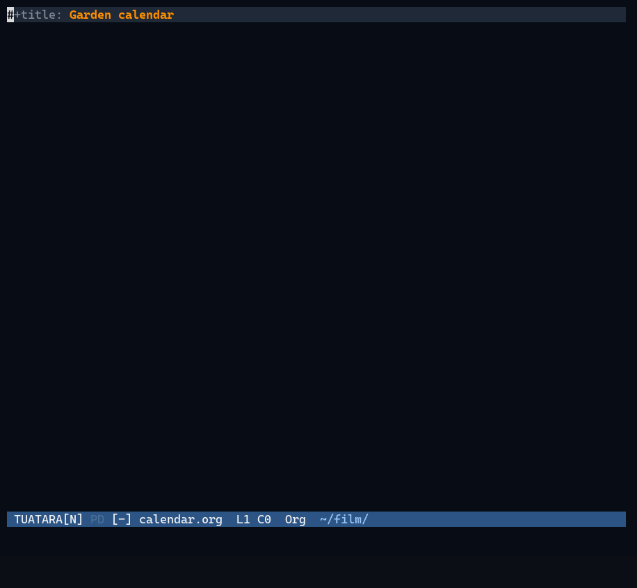

# caldav

Read the manual:
[tuatara-editor.github.io/tuatara-caldav](https://tuatara-editor.github.io/tuatara-caldav/).

Tuatara's agenda shared with GNOME Calendar, Thunderbird and phones, through
a CalDAV server all of them use: Radicale, which Fedora, Debian, Ubuntu and
Arch package, or EteSync through its own local bridge, etesync-dav, which
keeps the calendars encrypted end to end. One of the Tuatara project's
packages, not part of the editor.

The calendars are kept in an Org file and synced in both directions, in the
background. What you add or change in an entry goes to the server, and what
changed on the server comes into the entry. The manual sets up each server,
says where the password is kept, how the events are written as Org entries and
what to do when a sync fails.

<picture>
  <source media="(prefers-color-scheme: light)" srcset="media/caldav-light.gif">
  
</picture>

## What it needs

- Tuatara 0.90.47 or later.
- `curl`, which makes every request, and `secret-tool`, which keeps the
  server's password in your desktop's keyring. Most Linux systems have them.
- A CalDAV server, set up as the manual says.

Check the two programs in a terminal with `curl --version` and
`secret-tool --help`. If one says *command not found*, install it:

| System | Command |
|---|---|
| Fedora | `sudo dnf install curl libsecret` |
| Ubuntu, Debian | `sudo apt install curl libsecret-tools` |
| Arch, Omarchy | `sudo pacman -S curl libsecret` |
| Fedora Silverblue, other atomic systems | `rpm-ostree install libsecret`, then restart |

## Installing it, step by step

1. **Install what it needs**, with the command for your system above, and set
   up a server and an account as the manual says.
2. **Open your init file**: in Tuatara press `C-x C-f`, type
   `~/.config/tuatara/init.lisp` and press `RET`.
3. **Add this line** to it, with your own account:

   ```lisp
   (load-package "caldav" :source "https://github.com/Tuatara-Editor/tuatara-caldav"
     :config
     (setf *caldav-accounts*
           '((:name "EteSync" :url "http://localhost:37358/" :user "you"))))
   ```

4. **Save** with `C-x C-s`, **quit** with `C-x C-c`, and **start Tuatara
   again**. Answer `y` when it asks whether to load caldav; it asks once.
5. **Check it**: in an Org file press `C-c s l`. It lists the server's
   calendars, or says why it cannot reach it. Then `C-c s s` syncs.

## On a machine without internet

Tuatara compiles the package itself, so only fetching it needs the internet.
On a machine with internet:

```sh
git clone https://github.com/Tuatara-Editor/tuatara-caldav
git -C tuatara-caldav verify-tag "$(git -C tuatara-caldav describe --tags --abbrev=0)"
```

Copy the directory to the other machine, for instance to
`~/tuatara-packages/tuatara-caldav`, install curl and libsecret there from the
system's own packages, and name the directory in the init file:

```lisp
(load-package "caldav" :source "~/tuatara-packages/tuatara-caldav"
  :config
  (setf *caldav-accounts*
        '((:name "EteSync" :url "http://localhost:37358/" :user "you"))))
```

The server must be reachable from that machine, and a server on the same network
needs no internet. Carrying over the compiled files as well, so the other
machine skips the compiling, is in Tuatara's manual, chapter 19, "On a machine
without internet".

## Credits

- RFC 5545 (iCalendar): calendar files, values, rules of recurrence and time
  zones.
- RFC 4791 (CalDAV), RFC 6578 (changes since a sync token) and RFC 6764
  (finding a server's calendars): talking to the server.
- RFC 6868: parameter values in calendar files.
- Radicale and EteSync's etesync-dav: the servers it is used with.
- curl and secret-tool: how it reaches a server and keeps a password.

## License

GPL-3.0-or-later; see `LICENSE` at the top of this repository.

## Working on it

```sh
tools/test.sh
```

runs its tests against a Tuatara source tree: `../tuatara` beside this
repository, or `../../tuatara` beside the directory it is in, unless
`TUATARA_SOURCE` names another. How a package is laid out and which of
Tuatara's names it may use are in Tuatara's
[HACKING.org](https://github.com/Tuatara-Editor/tuatara/blob/main/HACKING.org);
bug reports, ideas and how changes are made in
[CONTRIBUTING.md](CONTRIBUTING.md). The manual's source is in `doc/manual/`;
`tools/manual-html.sh` in a Tuatara tree, given this repository's directory,
makes its pages.
